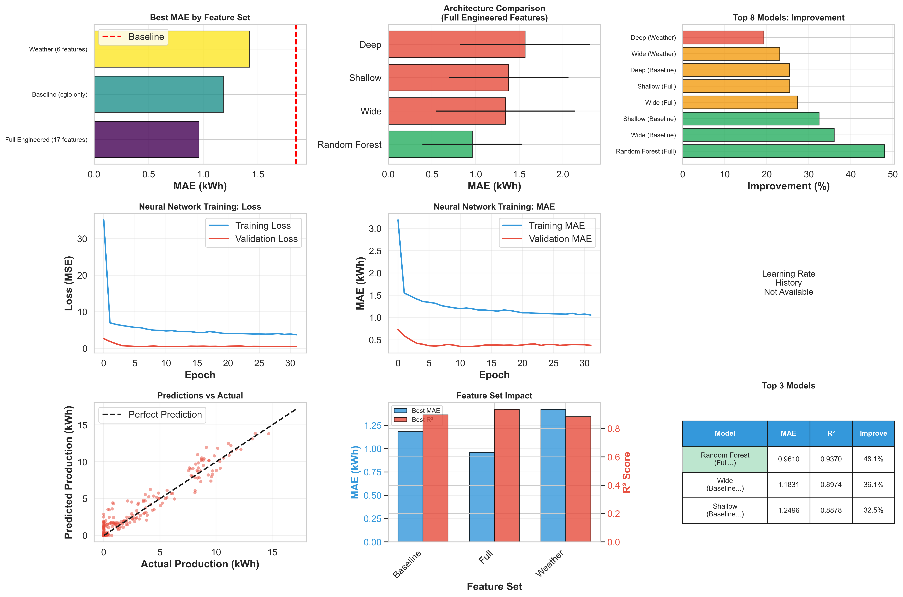

# PV Production Prediction

**First-semester final project for the course "Data modeling and big data simulation".**

Author: **Mohammad Rayhanul Haque**

Predicting hourly photovoltaic energy production in Graz, Austria, using weather measurements, time features, previous production values, classical regression and neural networks.



## What this project explores

- How data leakage and a seasonally unrepresentative test period affect reported accuracy.
- A simple persistence baseline: predict the previous observation's production.
- Chronological, expanding-window time-series cross-validation.
- Comparisons of Random Forest, Ridge, ElasticNet, gradient boosting, SVR and neural networks.
- Feature engineering using weather, cyclic time encoding, past production and interaction terms.
- An autoregressive forecasting experiment with Keras/TensorFlow.

[Open the original notebook and saved outputs](pv_prediction_rayhan.ipynb) | [Read the evaluation notes](docs/evaluation_notes.md)

## Data

The primary CSV contains **8,736 observations and 24 columns**, spanning **2021-01-01 00:00 UTC to 2021-12-31 00:00 UTC**.

| Field | Meaning |
|---|---|
| `diff_Nrg` | Hourly PV energy production: prediction target, in kWh |
| `Nrg` | Cumulative PV meter reading |
| `cglo` | Mean global irradiance |
| `tl` | Air temperature |
| `rf` | Relative humidity |
| `ff` | Wind speed |
| `p` | Air pressure |
| `rr` | Precipitation |
| `so_h` | Sunshine duration |

Detailed German-language descriptions and units are in [parameter_metadaten.csv](parameter_metadaten.csv). The original separate hourly weather-station CSV is also included. The notebook directly reads the merged PV/weather CSV.

The inputs are course-supplied files from the author's submission. Original provider attribution and redistribution licensing are not established by the filenames alone; no new blanket data license is asserted here.

## Recorded results

The following are **saved notebook results**, not a fresh training run during repository preparation.

| Experiment | Mean MAE (kWh) | Mean R-squared |
|---|---:|---:|
| Random Forest with engineered features | 0.9610 +/- 0.5700 | 0.9370 +/- 0.0401 |
| Wide Keras NN using irradiance only | 1.1831 +/- 0.5511 | 0.8974 +/- 0.0700 |
| Shallow Keras NN using irradiance only | 1.2496 +/- 0.6058 | 0.8878 +/- 0.0699 |

The +/- values describe variability across folds. Earlier notebook sections contain separate experiments, so their results should not be substituted into this table without checking feature sets, folds and aggregation.

The dashboard reports approximately **48.1% lower MAE** than a full-period persistence MAE of **1.8502 kWh**. This reference and the cross-validation predictions use different evaluation coverage, so that percentage is a recorded comparison, not a strictly matched-fold skill score.

A separate five-fold weather-feature experiment evaluates Random Forest and persistence on matching test folds and reports **1.157 kWh vs 1.998 kWh**, approximately **42.1% lower MAE**.

## Run locally

The notebook metadata records **Python 3.13.5**. Use a compatible Python 3.12/3.13 environment for its modern f-string syntax. `requirements.txt` provides a starting environment rather than an exact frozen copy of the original installation.

Download using **Code > Download ZIP**, extract the files, then open a terminal in that project folder. On Windows:

```powershell
py -3.13 -m venv .venv
.\.venv\Scripts\python.exe -m pip install -r requirements.txt
.\.venv\Scripts\python.exe -m jupyter lab pv_prediction_rayhan.ipynb
```

Use the Python executable for your installed version if different. Select the new environment's kernel if necessary.

Keep the notebook and CSV files together. Run cells in order because later experiments reuse variables and helper functions. **Skip the three installation cells** under "Keras + Tensorflow installation" after installing requirements: these are original environment-setup commands that upgrade pip/install TensorFlow/upgrade Keras. The supplied notebook preserves them for completeness.

Training all neural-network architectures over all folds can take several minutes or longer, depending on hardware. Saved outputs allow inspection without executing the training. Neural-network results can vary between runs.

## Repository contents

```text
pv-production-prediction/
  pv_prediction_rayhan.ipynb       Original submitted notebook, including outputs
  readings_pv_prod_and_weather.csv Merged model input
  parameter_metadaten.csv          Weather parameter definitions
  Messstationen ... .csv           Separate weather-station data
  requirements.txt                Suggested dependencies
  images/model_comparison.png     Original saved results dashboard
  docs/evaluation_notes.md         Interpretation and reproducibility notes
  docs/data_profile.json           Independently checked data summary
```

## Interpretation and limitations

- This is an academic project, not a production-ready or independently validated forecasting service.
- The course setup assumes weather inputs are known. The later experiment uses recorded future weather as a proxy for a perfect forecast.
- Lagged observed targets in one-step evaluation and recursively predicted targets in multi-step forecasting represent different tasks.
- The feature builder returns **16 features**; the dashboard's "17 features" label is inaccurate.
- The final December experiment has **145 observations**, not a complete 168-hour week; the provided data ends at midnight on December 31.
- More detailed caveats, including missing timestamps, validation reuse and baseline comparisons, are documented in [evaluation notes](docs/evaluation_notes.md).

## Preservation and checks

The notebook and three datasets are copied unchanged from the supplied project. Repository preparation checked notebook JSON, Python cell syntax (excluding the three shell-install cells), absence of stored error outputs, dataset shape and timestamp coverage. The complete training pipeline was **not rerun**.

The original notebook includes course starter instructions and intentionally flawed baseline examples followed by the student's solutions. Their presence is part of the academic record; read the later analysis and the evaluation notes before interpreting the initial scores.
